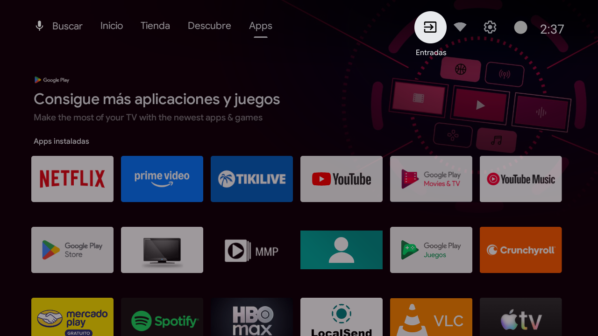
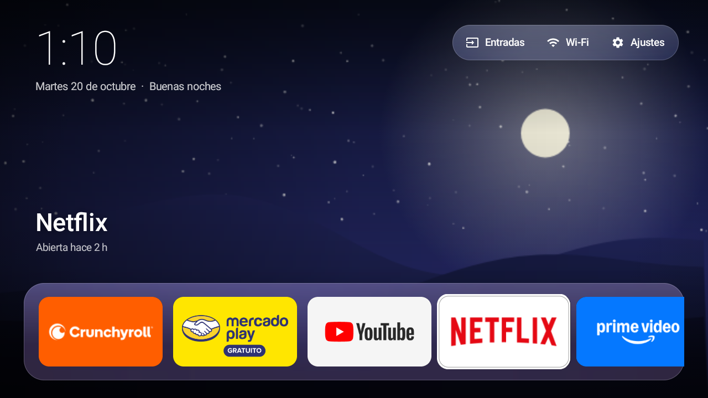
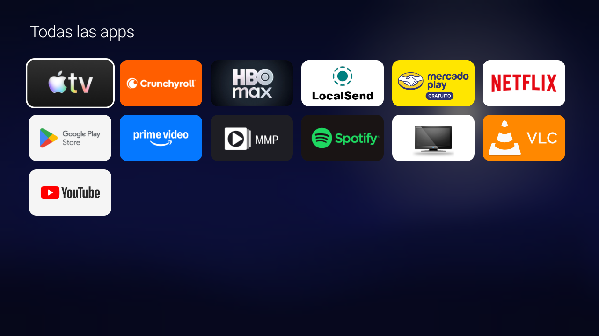

<div align="center">

# SlimTV

**Revive tu Android TV de 1 GB de RAM.**
Limpieza reversible + un launcher de 60 KB con efecto vidrio que corre a 60 fps en 1 GB de RAM.

[English](README.en.md) · [Proceso completo](docs/PROCESO.md) · [Cómo se hizo con IA](docs/IA.md) · [Agregar tu modelo](CONTRIBUTING.md)


</div>

| Antes: launcher de fábrica | Después: SlimTV |
|---|---|
|  |  |

---

## El problema

Muchas Android TV económicas (Hisense, TCL, Onn, marcas genéricas…) salen de fábrica con
**1 GB de RAM o menos**. Con el launcher de Google, las recomendaciones, la publicidad y las apps que
se cargan solas al encender, quedan apenas ~250 MB libres. Por eso los menús se traban y las apps tardan en abrir.

SlimTV no instala una ROM ni necesita root. Usa **ADB por Wi-Fi** (la herramienta oficial de Android)
para hacer cuatro cosas, **todas reversibles**:

1. **Desactivar el bloatware:** apps de fábrica, demos, publicidad y telemetría. Se desactivan, no se borran.
2. **Bloquear el arranque en segundo plano:** que Netflix, HBO Max & co. no se carguen solas al encender.
   *En TVs de 1 GB, esto es lo que más RAM libera.*
3. **Reemplazar el launcher** por uno propio, ultraligero: reloj, accesos a Entradas/Wi-Fi/Ajustes,
   una barra de vidrio con tus apps ordenadas por uso, "Seguías viendo", mini reproductor de Spotify
   y un protector de pantalla con paisajes generados por código.
4. **Acelerar las animaciones** del sistema.

## Resultados (Hisense HiSmart 2K ATV4, 903 MB de RAM)

| | Antes | Con SlimTV |
|---|---|---|
| RAM disponible | ~265 MB | **~393 MB** (+48 %) |
| Memoria del launcher | 115 MB (+31 MB de servicios asociados) | **23 MB** |
| Tamaño del launcher | — | **61 KB** (29 KB en la v1.0, sin vidrio ni extras) |
| Apps cargadas solas al encender | Netflix, HBO Max, Mercado Play… | **Ninguna** |

## El launcher

- **Arriba:** reloj, fecha y saludo. A la derecha, en una cápsula de vidrio: **Entradas** (HDMI), **Wi-Fi** y **Ajustes**.
- **Barra de vidrio:** hasta 10 apps **ordenadas por uso reciente** (al principio, tus favoritas de `config.xml`).
  La seleccionada se agranda y la barra se tiñe con el color de su marca. Al final, **Todas las apps**.
- **Seguías viendo:** al seleccionar una app aparece una tarjeta con lo último que reprodujiste, el progreso
  y cuánto falta. Funciona con las apps que lo publican en su sesión de reproducción (probado: Crunchyroll,
  YouTube y Spotify; Netflix y Prime Video no lo comparten).
- **Mini reproductor:** si Spotify suena de fondo, una píldora con carátula, canción y ⏮ ⏯ ⏭.
- **OK sostenido sobre una app:** menú para abrir, **fijar al principio**, quitar de la barra, olvidar lo
  último visto, liberar memoria, ver su información o desinstalarla.
- **Protector de pantalla:** los paisajes a pantalla completa con reloj grande y, solo si hay algo útil,
  lo que suena, lo último que veías o un aviso de "Sin internet". Se mueve cada 90 s.
- **Fondos:** 6 paisajes dibujados por código con bruma atmosférica. No usa fotos: ~1 MB de RAM.
- **Ligero a propósito:** Java puro, sin AndroidX y **sin internet**. El vidrio no desenfoca en vivo
  (Android 11 no puede): recorta una copia de 160×90 del fondo, así que no cuesta nada por cuadro.

| Rendimiento navegando (Hisense 2K ATV4, `dumpsys gfxinfo`) | v1.0 | v1.1 |
|---|---|---|
| Tiempo típico por cuadro | 5 ms | **5 ms** |
| Cuadros con tirones | 1.4 % | **~3–5 %** |
| Memoria del launcher (PSS, medida igual en las dos) | ~54 MB | **~39–54 MB** |



---

## Inicio rápido

### 1. Prepara la TV (una sola vez)
1. **Ajustes → Sistema → Acerca de** y pulsa **7 veces** sobre **Compilación** ("Ahora eres desarrollador").
2. **Ajustes → Sistema → Opciones de desarrollador** y activa **Depuración USB**.
3. Anota la **IP de la TV** (Ajustes → Red) y conecta la computadora al **mismo Wi-Fi**.

### 2. Elige cómo hacerlo

<details open>
<summary><b>Opción A · Con un agente de IA (la más fácil)</b></summary>

Así se creó este proyecto. Abre [Claude Code](https://claude.com/claude-code) (u otro agente con terminal)
dentro de esta carpeta y pega el contenido de **[PROMPT.md](PROMPT.md)**. El agente conecta la TV,
hace el diagnóstico, te propone qué desactivar, **te pregunta antes de cada cambio** e instala el launcher.

Más detalles en **[docs/IA.md](docs/IA.md)**.
</details>

<details>
<summary><b>Opción B · Manual con los scripts</b></summary>

Requiere [Platform-Tools (adb)](https://developer.android.com/tools/releases/platform-tools) y, para
compilar el launcher, el Android SDK más un JDK 11+. En Windows funcionan con PowerShell 5.1 o 7; en Mac/Linux, con [`pwsh`](https://learn.microsoft.com/powershell/scripting/install/installing-powershell).

```powershell
pwsh scripts/connect.ps1 -Ip 192.168.1.50     # acepta el aviso que sale en la TV
pwsh scripts/diagnose.ps1                     # qué consume RAM + respaldo del estado original
pwsh scripts/debloat.ps1 -List examples/hisense-2k-atv4/debloat.txt -DryRun   # revisa primero
pwsh scripts/debloat.ps1 -List examples/hisense-2k-atv4/debloat.txt
pwsh scripts/tweaks.ps1                       # animaciones al doble de velocidad
pwsh scripts/build.ps1 -Install               # compila e instala el launcher
pwsh scripts/restrict-background.ps1          # sin arranque en segundo plano
```

¿No hay lista para tu modelo? Copia la de Hisense, ajústala con lo que muestre `diagnose.ps1`
y prueba siempre con `-DryRun` antes de aplicar.
</details>

<details>
<summary><b>Opción C · Solo el launcher</b></summary>

Descarga `slimtv.apk` de [Releases](../../releases) e instálalo:

```powershell
pwsh scripts/install.ps1 -Apk ./slimtv.apk
```
</details>

### 3. ¿Algo no te gustó?

```powershell
pwsh scripts/restore.ps1
```

Reactiva todo, devuelve el segundo plano, restablece las animaciones y desinstala SlimTV.
Un **restablecimiento de fábrica** desde Ajustes también deshace todo.

---

## Personalizar el launcher

Edita [`launcher/res/values/config.xml`](launcher/res/values/config.xml) y recompila con `pwsh scripts/build.ps1 -Install`:

```xml
<string-array name="favorite_apps">   <!-- llenan la barra mientras no hay historial de uso -->
    <item>com.netflix.ninja</item>
    <item>com.google.android.youtube.tv</item>
    ...
</string-array>
<string-array name="music_apps">      <!-- las que controla el mini reproductor -->
    <item>com.spotify.tv.android</item>
</string-array>
<integer name="row_max">10</integer>
<integer name="grid_columns">6</integer>
<integer name="wallpaper_minutes">10</integer>
<integer name="screensaver_minutes">5</integer>
```

Fijar o quitar apps de la barra no requiere recompilar: mantén OK sobre la app.
Los colores de los paisajes están en `SCENES`, dentro de [`WallpaperView.java`](launcher/src/io/github/mlinescode/slimtv/WallpaperView.java).

## Scripts

| Script | Qué hace |
|---|---|
| `connect.ps1` | Conecta por Wi-Fi y guarda la IP |
| `diagnose.ps1` | Top de procesos por RAM, apps y launcher; respalda el estado original en `state/` |
| `debloat.ps1` | Desactiva los paquetes de una lista (con `-DryRun` para revisar) |
| `restrict-background.ps1` | Quita el permiso de segundo plano a las apps de usuario (menos las de música) |
| `tweaks.ps1` | Velocidad de las animaciones (`-Scale`, `-Reset`) |
| `build.ps1` | Compila el launcher **sin Gradle** → `dist/slimtv.apk` |
| `install.ps1` | Instala SlimTV, comprueba que abre y solo entonces desactiva el launcher de fábrica; da los permisos de uso y de sesiones y lo elige como protector de pantalla |
| `restore.ps1` | Deshace todo (incluido el protector de pantalla original) |

## Seguridad

- **Nada se desinstala:** se usa `pm disable-user`, que se revierte con `pm enable`.
- **Lista de protegidos:** los scripts se niegan a tocar Google Play Services, Play Store, SystemUI,
  Ajustes, el sintonizador, las entradas HDMI ni el control remoto, aunque estén en una lista
  (ver `$Protected` en [`scripts/common.ps1`](scripts/common.ps1)).
- **Todo queda registrado** en `state/<tv>/`, que es lo que `restore.ps1` usa para deshacer.
- **Sin root, sin desbloquear el bootloader, sin tocar el firmware.**
- **Permisos del launcher, sin internet:** uso de apps (para ordenar la barra) y sesiones de reproducción
  (para "Seguías viendo" y el mini reproductor). Android exige registrarlo como "lector de notificaciones"
  para ver las sesiones, pero SlimTV no lee ninguna notificación. Corre dentro del mismo proceso del launcher.

## Compatibilidad

Android TV / Google TV **8.0 o superior**. No aplica a Samsung (Tizen), LG (webOS) ni Fire TV.

| Modelo | Android | RAM | Estado |
|---|---|---|---|
| Hisense HiSmart 2K ATV4 | 11 | 903 MB | ✅ Probado · [detalles](examples/hisense-2k-atv4/) |
| ¿El tuyo? | | | [¡Agrégalo!](CONTRIBUTING.md) |

## Hecho con IA

SlimTV se diseñó, programó y probó **en una sola conversación con [Claude Code](https://claude.com/claude-code)**
(Anthropic), con el agente conectado a la TV real por ADB. La IA investigó, hizo el diagnóstico,
escribió el launcher y los scripts, y midió los resultados. El humano tomó las decisiones: qué apps usa,
qué desactivar y cuándo aplicar cada cambio. El proceso completo está en
**[docs/IA.md](docs/IA.md)** y el prompt para repetirlo en tu TV está en **[PROMPT.md](PROMPT.md)**.

## Créditos

- Inspirado en [tv-home](https://github.com/mihirgupta0900/tv-home) de Mihir Gupta (MIT), que hace lo mismo
  para TVs de 2 GB. SlimTV es una implementación propia, enfocada en equipos de ≤1 GB.
- Íconos: [Material Icons](https://fonts.google.com/icons) de Google (Apache 2.0).

## Licencia y aviso

[MIT](LICENSE) © 2026 Miguel Garcia.

SlimTV no tiene relación con Hisense, Google ni ningún fabricante. Modificar tu TV es **bajo tu propio
riesgo**: aunque todo es reversible, revisa siempre con `-DryRun` antes de aplicar una lista.
